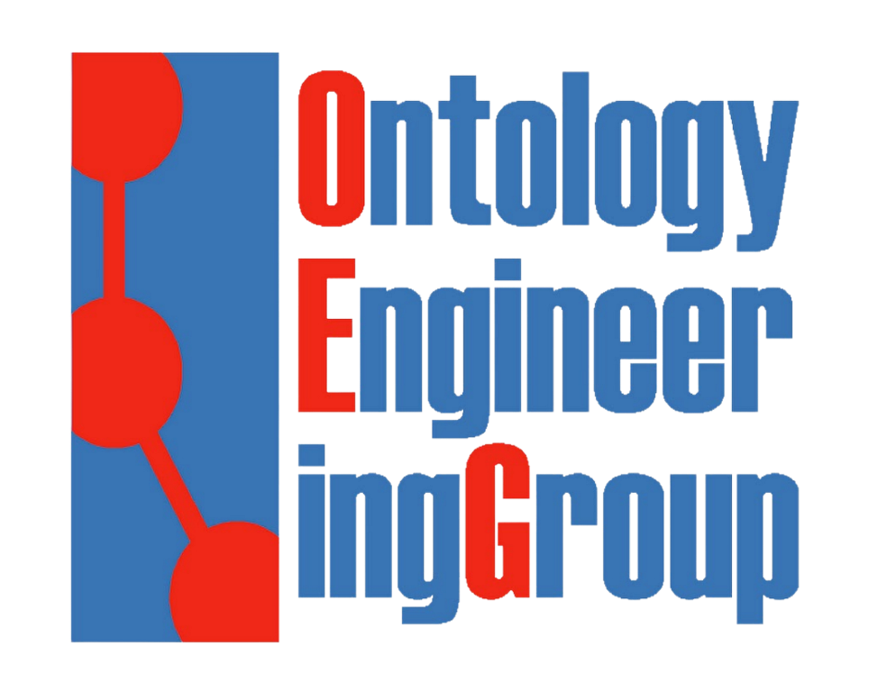

# RML

This page is an **introduction to [RML](https://w3id.org/rml/core/spec)**, the mapping language Morph-KGC reads. It starts from nothing and builds up, so you can follow it top to bottom on your first day with RML. Every snippet on this page runs against the **[running example](https://morph-kgc.readthedocs.io/en/latest/rml/#the-running-example)**: a fragment goes into a triples map like the one in **[Your First Mapping](https://morph-kgc.readthedocs.io/en/latest/rml/#your-first-mapping)**, and every result shown is the output Morph-KGC actually produces for it.

If you are looking for how to **configure and run the engine** instead, see the **[Documentation](https://morph-kgc.readthedocs.io/en/latest/documentation/)**. If you want the normative definition of the language, see the **[RML-Core specification](https://w3id.org/rml/core/spec)**.

## Concepts

An RML mapping says how to turn **records** of an input data source into **[RDF](https://www.w3.org/TR/rdf11-concepts/) triples**. A triple is three terms, always in the same order:

```
subject    predicate    object
```

It reads as a small sentence: *this thing* — *has this property* — *with this value*. A knowledge graph is a set of such sentences. Subjects and predicates are **IRIs** (identifiers); objects are either IRIs or **literals** (strings, numbers, dates).

A mapping is built from three nested pieces:

| Piece | What it does |
|---|---|
| **Logical source** | Names the data to read, and how to read it: a CSV file, a database table, a JSON document. |
| **Triples map** | Turns **one record** of that source into **one or more triples**. A mapping has as many triples maps as it needs. |
| **Term map** | Produces **one term** of a triple from the record: a subject, a predicate, an object, a graph. |

The engine reads the source record by record, and for each record it evaluates the term maps of each triples map and writes out the triples they form. Nothing is ordered, nothing is procedural: a mapping is a **declaration** of what the triples are, not a script that builds them.

RML is written in **[Turtle](https://www.w3.org/TR/turtle/)**, which is itself an RDF syntax. So a mapping is RDF that describes how to make RDF. That sounds circular but it is convenient in practice: mappings can be queried, validated and generated with the same tools as the data.

### The running example

Every example below maps this small film catalogue. Save the two files and you can run most of this page. The sections that read another kind of source, such as JSON, XML, a database or a web API, show the extra data they need where they use it.

`films.csv`:

``` csv
id,title,year,rating,director,genre,lang
1,Metropolis,1927,8.3,1,Sci-Fi,DE
2,M,1931,8.3,1,Thriller,DE
3,Rashomon,1950,8.2,2,Drama,JA
```

`directors.csv`:

``` csv
id,name,country
1,Fritz Lang,Austria
2,Akira Kurosawa,Japan
```

## Your First Mapping

Here is a complete mapping. It reads `films.csv` and gives every film a title.

``` turtle
@prefix rml: <http://w3id.org/rml/> .
@prefix ex:  <http://example.com/> .

<#FilmMapping> a rml:TriplesMap ;
    rml:logicalSource [
        rml:source "films.csv" ;
        rml:referenceFormulation rml:CSV
    ] ;
    rml:subjectMap [
        rml:template "http://example.com/film/{id}"
    ] ;
    rml:predicateObjectMap [
        rml:predicate ex:title ;
        rml:objectMap [ rml:reference "title" ]
    ] .
```

Read it from the inside out:

- The **logical source** is the file `films.csv`, read as CSV. Each row is one record.
- The **subject map** builds the subject from a **template**. `{id}` is replaced with the value of the `id` column, so row 1 gives `http://example.com/film/1`.
- The **predicate-object map** pairs a fixed predicate, `ex:title`, with an object taken from the `title` column.

Save it as `mapping.ttl`, put it next to `films.csv`, and run it from that directory with a configuration file that names the mapping:

``` ini
[FilmSource]
mappings: mapping.ttl
```

``` bash
morph-kgc config.ini
```

Relative paths in a mapping, like `films.csv` here, are resolved against the directory you run Morph-KGC from, not against the directory of the mapping file.

The result, in [N-Triples](https://www.w3.org/TR/n-triples/):

``` ntriples
<http://example.com/film/1> <http://example.com/title> "Metropolis" .
<http://example.com/film/2> <http://example.com/title> "M" .
<http://example.com/film/3> <http://example.com/title> "Rashomon" .
```

Three rows in, three triples out. Everything that follows is a variation on this.

## Term Maps

A term map is the unit that produces one term. There are four kinds, and they are the whole vocabulary you need for subjects, predicates, objects and graphs alike.

| Term map | Produces | Example |
|---|---|---|
| **`rml:constant`** | The same term for every record. | `rml:constant ex:Film` |
| **`rml:reference`** | The value of one column, field or element. | `rml:reference "title"` |
| **`rml:template`** | A string with `{...}` placeholders filled from the record. | `rml:template "http://example.com/film/{id}"` |
| **`rml:functionExecution`** | The result of a [transformation function](https://morph-kgc.readthedocs.io/en/latest/rml/#transformation-functions). | `rml:functionExecution <#Upper>` |

A record that has **no value** for a reference the term map needs produces **no term**, and therefore no triple. This is how NULL and missing fields are handled: they are skipped, not turned into empty strings. Which values count as missing is set with `na_values` in the **[engine configuration](https://morph-kgc.readthedocs.io/en/latest/documentation/#engine-configuration)**.

## Subjects

The subject map says what each record is *about*. In practice it is almost always a template, because the point is to mint one stable identifier per record.

``` turtle
rml:subjectMap [
    rml:template "http://example.com/film/{id}" ;
    rml:class ex:Film
]
```

`rml:class` is a shorthand for the `rdf:type` triple everybody writes anyway. The mapping above produces, for each film, both its own triples and:

``` ntriples
<http://example.com/film/1> <http://www.w3.org/1999/02/22-rdf-syntax-ns#type> <http://example.com/Film> .
```

A subject is an IRI by default. When a record describes something that needs no global identifier — an event, a measurement, an address — use a **blank node** instead:

``` turtle
rml:subjectMap [
    rml:template "screening{id}" ;
    rml:termType rml:BlankNode
]
```

``` ntriples
_:screening1 <http://example.com/of> <http://example.com/film/1> .
_:screening2 <http://example.com/of> <http://example.com/film/2> .
_:screening3 <http://example.com/of> <http://example.com/film/3> .
```

{==

*__Note:__ values interpolated into a template that produces an **IRI** are **percent-encoded**, so a title containing a space or a slash still yields a valid IRI. A template that produces a literal is filled in as is. Set `safe_percent_encoding` in the [engine configuration](https://morph-kgc.readthedocs.io/en/latest/documentation/#engine-configuration) to exempt characters you want to keep literal.*

==}

## Predicates and Objects

A triples map may carry any number of predicate-object maps, and each one contributes its own triples for every record.

``` turtle
@prefix rml:  <http://w3id.org/rml/> .
@prefix ex:   <http://example.com/> .
@prefix xsd:  <http://www.w3.org/2001/XMLSchema#> .
@prefix rdfs: <http://www.w3.org/2000/01/rdf-schema#> .

<#FilmMapping> a rml:TriplesMap ;
    rml:logicalSource [
        rml:source "films.csv" ;
        rml:referenceFormulation rml:CSV
    ] ;
    rml:subjectMap [
        rml:template "http://example.com/film/{id}" ;
        rml:class ex:Film
    ] ;
    rml:predicateObjectMap [
        rml:predicate rdfs:label ;
        rml:objectMap [ rml:reference "title" ]
    ] ;
    rml:predicateObjectMap [
        rml:predicate ex:year ;
        rml:objectMap [ rml:reference "year" ; rml:datatype xsd:gYear ]
    ] ;
    rml:predicateObjectMap [
        rml:predicate ex:rating ;
        rml:objectMap [ rml:reference "rating" ; rml:datatype xsd:decimal ]
    ] .
```

``` ntriples
<http://example.com/film/1> <http://www.w3.org/1999/02/22-rdf-syntax-ns#type> <http://example.com/Film> .
<http://example.com/film/1> <http://www.w3.org/2000/01/rdf-schema#label> "Metropolis" .
<http://example.com/film/1> <http://example.com/year> "1927"^^<http://www.w3.org/2001/XMLSchema#gYear> .
<http://example.com/film/1> <http://example.com/rating> "8.3"^^<http://www.w3.org/2001/XMLSchema#decimal> .
<http://example.com/film/2> <http://www.w3.org/1999/02/22-rdf-syntax-ns#type> <http://example.com/Film> .
<http://example.com/film/2> <http://www.w3.org/2000/01/rdf-schema#label> "M" .
...
```

An object can be built the same four ways a subject can. A **constant** gives every record the same value, and a **template** mints a related IRI:

``` turtle
rml:predicateObjectMap [
    rml:predicate ex:medium ;
    rml:objectMap [ rml:constant "film" ]
] ;
rml:predicateObjectMap [
    rml:predicate ex:page ;
    rml:objectMap [ rml:template "http://example.com/page/{id}/{title}" ]
] .
```

``` ntriples
<http://example.com/film/1> <http://example.com/medium> "film" .
<http://example.com/film/1> <http://example.com/page> <http://example.com/page/1/Metropolis> .
```

### Term types

Whether an object comes out as an IRI or a literal follows from how it was built, and `rml:termType` overrides the default:

| Object map | Default term type |
|---|---|
| **`rml:reference`** | Literal |
| **`rml:template`** | IRI |
| **`rml:constant`** | Whatever the constant is written as: an IRI if written as one, a literal if quoted |
| **`rml:functionExecution`** | Literal |

So a reference needs no annotation to become a literal, and a template needs none to become an IRI. A [function execution](https://morph-kgc.readthedocs.io/en/latest/rml/#transformation-functions) is a literal as well, so a function returning an identifier does need the annotation. Say so explicitly only when you want the other one:

``` turtle
rml:objectMap [ rml:template "{title}-{year}" ; rml:termType rml:Literal ]
```

``` ntriples
<http://example.com/film/1> <http://example.com/slug> "Metropolis-1927" .
<http://example.com/film/2> <http://example.com/slug> "M-1931" .
```

### Shortcuts

Constant-valued term maps are so common that RML gives them one-word forms. These two are the same mapping:

``` turtle
rml:predicateObjectMap [
    rml:predicateMap [ rml:constant rdfs:label ] ;
    rml:objectMap    [ rml:constant "film" ]
] .

rml:predicateObjectMap [
    rml:predicate rdfs:label ;
    rml:object    "film"
] .
```

The same holds for `rml:subject`, `rml:graph`, `rml:datatype` and `rml:language`. A predicate-object map may also list **several predicates** for one object, which saves repeating the object map:

``` turtle
@prefix dct: <http://purl.org/dc/terms/> .

rml:predicateObjectMap [
    rml:predicate rdfs:label, dct:title ;
    rml:objectMap [ rml:reference "title" ]
] .
```

``` ntriples
<http://example.com/film/1> <http://www.w3.org/2000/01/rdf-schema#label> "Metropolis" .
<http://example.com/film/1> <http://purl.org/dc/terms/title> "Metropolis" .
```

## Literals

An object that is not an IRI is a literal, and a literal carries a **datatype** or a **language**, not both.

``` turtle
rml:objectMap [ rml:reference "rating" ; rml:datatype xsd:decimal ]
rml:objectMap [ rml:reference "title"  ; rml:language "en" ]
```

``` ntriples
<http://example.com/film/1> <http://example.com/rating> "8.3"^^<http://www.w3.org/2001/XMLSchema#decimal> .
<http://example.com/film/1> <http://example.com/titleEn> "Metropolis"@en .
```

Give an object map one or the other. Morph-KGC does not reject an object map with both, but it then writes **two** literals per record, one with the language and one with the datatype.

`rml:datatype` is a statement about the data, and Morph-KGC mostly takes it at its word: it does **not** check that the value fits the datatype, so `rml:reference "title" ; rml:datatype xsd:decimal` produces the ill-typed literal `"Metropolis"^^xsd:decimal` rather than an error. Three datatypes are the exception, because their values are rewritten:

| Datatype | What happens to the value |
|---|---|
| **`xsd:integer`** | It is read as a number and truncated, so `8.3` becomes `"8"`. A value that is not a number, like `Metropolis`, **stops the run** with an error. |
| **`xsd:boolean`** | It is lower-cased: `TRUE` becomes `"true"`. |
| **`xsd:dateTime`** | A space becomes `T`: `1927-02-06 20:00:00` becomes `"1927-02-06T20:00:00"`. |

When the datatype or the language varies per record, take it from the data with `rml:datatypeMap` or `rml:languageMap`. The `lang` column of `films.csv` holds the language each film was shot in:

``` turtle
rml:predicateObjectMap [
    rml:predicate ex:originalTitle ;
    rml:objectMap [
        rml:reference "title" ;
        rml:languageMap [ rml:reference "lang" ]
    ]
] .
```

``` ntriples
<http://example.com/film/1> <http://example.com/originalTitle> "Metropolis"@DE .
<http://example.com/film/2> <http://example.com/originalTitle> "M"@DE .
<http://example.com/film/3> <http://example.com/originalTitle> "Rashomon"@JA .
```

Language tags are written exactly as the data spells them; Morph-KGC does not normalize them. To clean them up, make the language map the result of a **[function](https://morph-kgc.readthedocs.io/en/latest/rml/#transformation-functions)**:

``` turtle
rml:predicateObjectMap [
    rml:predicate ex:originalTitle ;
    rml:objectMap [
        rml:reference "title" ;
        rml:languageMap [ rml:functionExecution <#LowerCaseLang> ]
    ]
] .

<#LowerCaseLang>
    rml:function grel:toLowerCase ;
    rml:input [
        rml:parameter grel:valueParameter ;
        rml:inputValueMap [ rml:reference "lang" ]
    ] .
```

``` ntriples
<http://example.com/film/1> <http://example.com/originalTitle> "Metropolis"@de .
<http://example.com/film/2> <http://example.com/originalTitle> "M"@de .
<http://example.com/film/3> <http://example.com/originalTitle> "Rashomon"@ja .
```

A datatype map can be a function execution in the same way, and both work inside [triple terms](https://morph-kgc.readthedocs.io/en/latest/rml/#triple-terms-and-reification) too.

For relational sources you can also let the engine read the datatype off the database schema, by setting `infer_sql_datatypes` in the **[engine configuration](https://morph-kgc.readthedocs.io/en/latest/documentation/#engine-configuration)**. A `REAL` column then gives `xsd:double` literals and an `INTEGER` column `xsd:integer` ones. This covers references into a table named with `rml:tableName`; the columns of a [view](https://morph-kgc.readthedocs.io/en/latest/rml/#views) get no datatype.

## Named Graphs

Triples can be placed in a **named graph**, which is how you keep provenance, versions or access tiers apart in one store. Add a graph map to a subject map (it then covers every triple of the triples map) or to a single predicate-object map:

``` turtle
rml:predicateObjectMap [
    rml:predicate rdfs:label ;
    rml:objectMap [ rml:reference "title" ] ;
    rml:graphMap [ rml:constant ex:CatalogueGraph ]
] .
```

Named graphs only survive in a **quad** serialization, so set `output_format` to `N-QUADS`:

``` nquads
<http://example.com/film/1> <http://www.w3.org/2000/01/rdf-schema#label> "Metropolis" <http://example.com/CatalogueGraph> .
<http://example.com/film/2> <http://www.w3.org/2000/01/rdf-schema#label> "M" <http://example.com/CatalogueGraph> .
<http://example.com/film/3> <http://www.w3.org/2000/01/rdf-schema#label> "Rashomon" <http://example.com/CatalogueGraph> .
```

From Python, `morph_kgc.materialize` then returns an RDFLib **Dataset**, which keeps the named graphs apart; see **[Library](https://morph-kgc.readthedocs.io/en/latest/documentation/#library)**.

## Logical Sources

So far every example read a CSV file. The logical source is the one part of a mapping that changes with the input format; the term maps above stay exactly as they are.

### Files

Name the file with `rml:source` and say how to read it with `rml:referenceFormulation`. For tabular files the references are **column names**.

``` turtle
rml:logicalSource [
    rml:source "films.csv" ;
    rml:referenceFormulation rml:CSV
]
```

The file may be a **local path or a URL**, and can also be given (or overridden) with `file_path` in the configuration file. Morph-KGC reads CSV, TSV, Excel, ODS, Parquet, GeoParquet, Shapefile, Feather, ORC, Stata, SAS and SPSS, and also JSON, GeoJSON and XML, which the next section covers; see **[Advanced Setup](https://morph-kgc.readthedocs.io/en/latest/documentation/#advanced-setup)** for the extras each one needs.

### Hierarchical Data

JSON and XML records are nested rather than flat, so a logical source over them needs an **iterator**: the expression that says which nodes are the records. References are then relative to each record. Morph-KGC takes the iterator as a **[JSONPath](https://goessner.net/articles/JsonPath/)** expression for JSON and an **[XPath 3.0](https://www.w3.org/TR/xpath30/)** one for XML. The references are simpler paths, as described below.

``` turtle
rml:logicalSource [
    rml:source "films.json" ;
    rml:referenceFormulation rml:JSONPath ;
    rml:iterator "$.films[*]"
]
```

``` json
{
  "films": [
    { "id": 1, "title": "Metropolis", "year": 1927,
      "director": { "name": "Fritz Lang" }, "genres": ["Sci-Fi", "Drama"] },
    { "id": 2, "title": "M", "year": 1931,
      "director": { "name": "Fritz Lang" }, "genres": ["Thriller"] }
  ]
}
```

``` ntriples
<http://example.com/film/1> <http://www.w3.org/2000/01/rdf-schema#label> "Metropolis" .
<http://example.com/film/2> <http://www.w3.org/2000/01/rdf-schema#label> "M" .
```

A JSON reference is a **dot-separated path of keys** from the record, and a reference to an array produces one term per element:

``` turtle
rml:predicateObjectMap [
    rml:predicate ex:director ;
    rml:objectMap [ rml:reference "director.name" ]
] ;
rml:predicateObjectMap [
    rml:predicate ex:genre ;
    rml:objectMap [ rml:reference "genres" ]
] .
```

``` ntriples
<http://example.com/film/1> <http://example.com/director> "Fritz Lang" .
<http://example.com/film/1> <http://example.com/genre> "Sci-Fi" .
<http://example.com/film/1> <http://example.com/genre> "Drama" .
<http://example.com/film/2> <http://example.com/director> "Fritz Lang" .
<http://example.com/film/2> <http://example.com/genre> "Thriller" .
```

A reference may also start with `$.`, as in `rml:reference "$.title"` or `rml:template "http://example.com/film/{$.id}"`, which is how the RML test cases write them. Any other JSONPath syntax in a reference, such as `$.genres[*]`, matches nothing and produces no triples. A record whose referenced key is missing or `null` produces no term for that term map, and the other predicate-object maps of the record are unaffected.

XML works the same way with `rml:XPath`, and `@` reads an attribute:

``` turtle
rml:logicalSource [
    rml:source "films.xml" ;
    rml:referenceFormulation rml:XPath ;
    rml:iterator "/films/film"
] ;
rml:subjectMap [ rml:template "http://example.com/film/{@id}" ]
```

``` xml
<films>
  <film id="1"><title>Metropolis</title><year>1927</year></film>
  <film id="2"><title>M</title><year>1931</year></film>
</films>
```

The iterator can use the whole of XPath 3.0, predicates included: `/films/film[year < 1930]` keeps only Metropolis. A reference, however, is an **element path** relative to the record, like `title`, `./title` or `director/name`, optionally ending in an attribute such as `@id` or `director/@name`. XPath functions and steps such as `text()` or `upper-case(title)` are not supported in references and stop the run with an error. A reference that matches several elements produces one term per match.

### Web APIs

A logical source can also be a **web API** that answers with JSON. Describe the request with the **[HTTP Vocabulary in RDF](https://www.w3.org/TR/HTTP-in-RDF10/)** and make it the `rml:source`; the response is then read like a JSON file, with an iterator:

``` turtle
@prefix rml:  <http://w3id.org/rml/> .
@prefix ex:   <http://example.com/> .
@prefix rdfs: <http://www.w3.org/2000/01/rdf-schema#> .
@prefix htv:  <http://www.w3.org/2011/http#> .

<#FilmsAPI> a htv:Request ;
    htv:absoluteURI "https://api.example.com/films" ;
    htv:headers (
        [ htv:fieldName "Authorization" ; htv:fieldValue "Bearer {FILMS_API_TOKEN}" ]
        [ htv:fieldName "genre" ; htv:fieldValue "drama" ]
    ) .

<#FilmMapping> a rml:TriplesMap ;
    rml:logicalSource [
        rml:source <#FilmsAPI> ;
        rml:referenceFormulation rml:JSONPath ;
        rml:iterator "$.films[*]"
    ] ;
    rml:subjectMap [ rml:template "http://example.com/film/{id}" ] ;
    rml:predicateObjectMap [
        rml:predicate rdfs:label ;
        rml:objectMap [ rml:reference "title" ]
    ] ;
    rml:predicateObjectMap [
        rml:predicate ex:year ;
        rml:objectMap [ rml:reference "year" ]
    ] .
```

``` bash
export FILMS_API_TOKEN=...
morph-kgc config.ini
```

Morph-KGC sends a `GET https://api.example.com/films?genre=drama` with the header `Authorization: Bearer ...`, and the API answers `{"films": [{"id": 3, "title": "Rashomon", "year": 1950}]}`:

``` ntriples
<http://example.com/film/3> <http://www.w3.org/2000/01/rdf-schema#label> "Rashomon" .
<http://example.com/film/3> <http://example.com/year> "1950" .
```

The `htv:headers` list holds the fields of the request:

- **`Authorization`**, **`Accept`**, **`KeyId`** and **`User-Agent`** are sent as HTTP headers. Every other field is sent as a **query-string parameter**, which is how `genre` became `?genre=drama`.
- A `{VAR}` placeholder in a value is filled from the **environment**, and so is a value that is just the name of an environment variable, so a token never has to be written into the mapping. An unset variable stops the run before any request is made.
- For tokens kept elsewhere, set `api_token` in the **[engine configuration](https://morph-kgc.readthedocs.io/en/latest/documentation/#engine-configuration)** to a Python file with a `get_api_token(value)` function. Each remaining value is passed to it, and whatever it returns is sent instead; when it returns nothing, the value is sent as written.

Write the references without a leading `$.` here: `rml:reference "$.title"` matches nothing in an API response. Credentials written into the URL itself are rejected, and a request the API refuses (for example with `401 Unauthorized`) stops the run with an error that gives the status. The API is requested again for every predicate-object map (and `rml:class`) that reads it, and again when it is the parent of a join, so it should give the same answer every time.

### Relational Databases

For a database, the connection lives in the **configuration file** and the mapping only names the table. To try it, load the two files of the running example into a SQLite database, `films.db`:

``` python
import sqlite3
import pandas as pd

with sqlite3.connect('films.db') as connection:
    pd.read_csv('films.csv').to_sql('films', connection, index=False)
    pd.read_csv('directors.csv').to_sql('directors', connection, index=False)
```

Then name it in the configuration file:

``` ini
[FilmSource]
mappings: mapping.ttl
db_url: sqlite:///films.db
```

``` turtle
rml:logicalSource [
    rml:tableName "films" ;
    rml:referenceFormulation rml:SQL2008
]
```

``` ntriples
<http://example.com/film/1> <http://www.w3.org/1999/02/22-rdf-syntax-ns#type> <http://example.com/Film> .
<http://example.com/film/1> <http://www.w3.org/2000/01/rdf-schema#label> "Metropolis" .
<http://example.com/film/2> <http://www.w3.org/1999/02/22-rdf-syntax-ns#type> <http://example.com/Film> .
<http://example.com/film/2> <http://www.w3.org/2000/01/rdf-schema#label> "M" .
...
```

Keeping the connection out of the mapping is deliberate: the same mapping then runs against a developer's SQLite copy and against production, and no credential is ever committed with it. The supported systems and their URL forms are listed under **[Data Sources](https://morph-kgc.readthedocs.io/en/latest/documentation/#relational-databases)**.

{==

*__Note:__ Morph-KGC is **case sensitive** about identifiers. Table and column names in the mapping must match the data source exactly.*

==}

A **[Neo4j](https://neo4j.com/)** property graph is configured the same way, with a `db_url`. Its logical sources hold a **[Cypher](https://neo4j.com/docs/cypher-manual/current/introduction/)** query in `rml:query`, with the `rml:Cypher` reference formulation, and the references are the names the query returns.

### In-Memory Data

A logical source can also be a **[Pandas DataFrame](https://pandas.pydata.org/docs/reference/api/pandas.DataFrame.html)** or a **Python dictionary** you pass in from your own code, described with the **[SD Ontology](https://knowledgecaptureanddiscovery.github.io/SoftwareDescriptionOntology/release/1.8.0/index-en.html)**. The `sd:name` is the key the object arrives under.

``` turtle
@prefix sd: <https://w3id.org/okn/o/sd#> .

rml:logicalSource [
    rml:source [ a sd:DatasetSpecification ; sd:name "films" ] ;
    rml:referenceFormulation rml:DataFrame
]
```

``` python
import morph_kgc
import pandas as pd

films_df = pd.DataFrame({'id': [1, 2], 'title': ['Metropolis', 'M']})

graph = morph_kgc.materialize('config.ini', {'films': films_df})
```

``` ntriples
<http://example.com/film/1> <http://www.w3.org/2000/01/rdf-schema#label> "Metropolis" .
<http://example.com/film/2> <http://www.w3.org/2000/01/rdf-schema#label> "M" .
```

With `rml:DataFrame`, the object can also be a list of records, such as `[{'id': 1, 'title': 'Metropolis'}, {'id': 2, 'title': 'M'}]`. For a nested Python dictionary, or a JSON string, use `rml:Dictionary` instead, with an `rml:iterator` as for JSON:

``` turtle
rml:logicalSource [
    rml:source [ a sd:DatasetSpecification ; sd:name "films" ] ;
    rml:referenceFormulation rml:Dictionary ;
    rml:iterator "$.films[*]"
]
```

``` python
films = {'films': [{'id': 1, 'title': 'Metropolis'}, {'id': 2, 'title': 'M'}]}

graph = morph_kgc.materialize('config.ini', {'films': films})
```

In-memory data can only be passed through the **[library](https://morph-kgc.readthedocs.io/en/latest/documentation/#library)**, not from the command line, and only `rml:DataFrame` and `rml:Dictionary` read it.

{==

*__Note:__ double quotes are removed from the string values of a DataFrame, so `The "Big" Sleep` is mapped as `The Big Sleep`.*

==}

## Joins

Real data is spread over several sources, and the whole point of a knowledge graph is to connect it. A **referencing object map** makes the object of a triple be the subject minted by *another* triples map, joining the two sources on a condition.

`films.csv` refers to a director by number. To turn that number into a link, point at the triples map that mints director IRIs:

``` turtle
@prefix rml:  <http://w3id.org/rml/> .
@prefix ex:   <http://example.com/> .
@prefix rdfs: <http://www.w3.org/2000/01/rdf-schema#> .

<#FilmMapping> a rml:TriplesMap ;
    rml:logicalSource [
        rml:source "films.csv" ; rml:referenceFormulation rml:CSV
    ] ;
    rml:subjectMap [ rml:template "http://example.com/film/{id}" ] ;
    rml:predicateObjectMap [
        rml:predicate ex:directedBy ;
        rml:objectMap [
            rml:parentTriplesMap <#DirectorMapping> ;
            rml:joinCondition [
                rml:child  "director" ;
                rml:parent "id"
            ]
        ]
    ] .

<#DirectorMapping> a rml:TriplesMap ;
    rml:logicalSource [
        rml:source "directors.csv" ; rml:referenceFormulation rml:CSV
    ] ;
    rml:subjectMap [
        rml:template "http://example.com/director/{id}" ;
        rml:class ex:Director
    ] ;
    rml:predicateObjectMap [
        rml:predicate rdfs:label ;
        rml:objectMap [ rml:reference "name" ]
    ] .
```

``` ntriples
<http://example.com/film/1> <http://example.com/directedBy> <http://example.com/director/1> .
<http://example.com/film/2> <http://example.com/directedBy> <http://example.com/director/1> .
<http://example.com/film/3> <http://example.com/directedBy> <http://example.com/director/2> .
<http://example.com/director/1> <http://www.w3.org/1999/02/22-rdf-syntax-ns#type> <http://example.com/Director> .
<http://example.com/director/1> <http://www.w3.org/2000/01/rdf-schema#label> "Fritz Lang" .
<http://example.com/director/2> <http://www.w3.org/1999/02/22-rdf-syntax-ns#type> <http://example.com/Director> .
<http://example.com/director/2> <http://www.w3.org/2000/01/rdf-schema#label> "Akira Kurosawa" .
```

`rml:child` names the reference in **this** source, `rml:parent` the reference in the **parent** triples map's source. Several join conditions on one referencing object map are combined with **AND**, which is how you join on a composite key. Against a source of screenings keyed by city and time slot, which the running example does not have, it reads:

``` turtle
rml:objectMap [
    rml:parentTriplesMap <#HallMapping> ;
    rml:joinCondition [ rml:child "city" ; rml:parent "city" ] ;
    rml:joinCondition [ rml:child "slot" ; rml:parent "slot" ]
]
```

A child record that matches no parent record produces no triple, and one that matches several produces one triple per match.

The two sources need not be of the same kind, and joining a CSV file against a database table is the cheapest way to integrate data that has never shared a system. A `db_url` applies to every logical source of its section of the configuration file, though, so the file and the table must be mapped in **separate sections**, and therefore in separate mapping files:

``` ini
[FilmSource]
mappings: films.ttl

[DirectorSource]
mappings: directors.ttl
db_url: sqlite:///films.db
```

`films.ttl` holds `<#FilmMapping>` as above, and `directors.ttl` holds `<#DirectorMapping>` with `rml:tableName "directors"` as its logical source. A relative IRI like `<#DirectorMapping>` is resolved against the file it is written in, so give both files the same `@base`, for instance `@base <http://example.com/mapping> .`, or the film mapping looks for a director mapping that does not exist.

## Views

Sometimes the shape you want is not the shape the source has: you need a filter, a computed column, a pre-aggregation, or a join that RML's join condition cannot express. A **view** lets you write that in SQL and map the result.

Give the logical source an `rml:query` instead of a source and a reference formulation. Over **files**, Morph-KGC evaluates the query with **[DuckDB](https://duckdb.org/)**, so a CSV or Parquet file is queried by name, relative to the directory you run Morph-KGC from:

``` turtle
@prefix rml:  <http://w3id.org/rml/> .
@prefix ex:   <http://example.com/> .
@prefix rdfs: <http://www.w3.org/2000/01/rdf-schema#> .

<#SilentFilmMapping> a rml:TriplesMap ;
    rml:logicalSource [
        rml:query """
            SELECT id, title, year
            FROM 'films.csv'
            WHERE year < 1930
        """
    ] ;
    rml:subjectMap [
        rml:template "http://example.com/film/{id}" ;
        rml:class ex:SilentFilm
    ] ;
    rml:predicateObjectMap [
        rml:predicate rdfs:label ;
        rml:objectMap [ rml:reference "title" ]
    ] .
```

``` ntriples
<http://example.com/film/1> <http://www.w3.org/1999/02/22-rdf-syntax-ns#type> <http://example.com/SilentFilm> .
<http://example.com/film/1> <http://www.w3.org/2000/01/rdf-schema#label> "Metropolis" .
```

Over a **database** the query is sent to the database itself, and the references are the projected column names:

``` turtle
rml:logicalSource [
    rml:query "SELECT id, title FROM films WHERE year < 1930" ;
    rml:referenceFormulation rml:SQL2008
]
```

Views are also the way to handle **mixed content**, a field that packs several values into one string. DuckDB's `UNNEST` and JSON functions turn one such row into the several records RML then maps one by one. The supported syntax is DuckDB's; see its **[SQL documentation](https://duckdb.org/docs/sql/introduction)** and its **[JSON extension](https://duckdb.org/docs/extensions/json.html)**.

{==

*__Note:__ the query runs before any triple is generated, so pushing a filter into it is usually faster than generating triples and discarding them later. It runs again for every predicate-object map that reads the view, so keep it cheap.*

==}

## Transformation Functions

Data rarely arrives in the shape the ontology wants. **[RML-FNML](https://w3id.org/rml/fnml/spec)** lets a term map be the **result of a function call** rather than a plain value.

A function call is written as a separate node and referenced with `rml:functionExecution`. The node names the function with `rml:function` and binds each argument with an `rml:input`, pairing a parameter IRI with either a value from the data (`rml:inputValueMap`) or a constant (`rml:inputValue`).

### Built-in Functions

Morph-KGC ships a subset of the **[GREL functions](http://users.ugent.be/~bjdmeest/function/grel.ttl#)** ready to use:

``` turtle
@prefix rml:  <http://w3id.org/rml/> .
@prefix ex:   <http://example.com/> .
@prefix grel: <http://users.ugent.be/~bjdmeest/function/grel.ttl#> .

<#FilmMapping> a rml:TriplesMap ;
    rml:logicalSource [
        rml:source "films.csv" ; rml:referenceFormulation rml:CSV
    ] ;
    rml:subjectMap [ rml:template "http://example.com/film/{id}" ] ;
    rml:predicateObjectMap [
        rml:predicate ex:shoutedTitle ;
        rml:objectMap [ rml:functionExecution <#Upper> ]
    ] .

<#Upper>
    rml:function grel:toUpperCase ;
    rml:input [
        rml:parameter grel:valueParameter ;
        rml:inputValueMap [ rml:reference "title" ]
    ] .
```

``` ntriples
<http://example.com/film/1> <http://example.com/shoutedTitle> "METROPOLIS" .
<http://example.com/film/2> <http://example.com/shoutedTitle> "M" .
<http://example.com/film/3> <http://example.com/shoutedTitle> "RASHOMON" .
```

Most built-in functions take their main value through **`grel:valueParameter`**, and some take further parameters, such as the separator `grel:p_string_sep` of `grel:string_split`. The complete set, with the parameter IRIs each one expects, is **[here](https://github.com/morph-kgc/morph-kgc/tree/main/src/morph_kgc/functions/grel)** — string, math, date, array and control functions. Functions that are Morph-KGC's own, such as hashing, UUIDs and `coalesce`, live in the `https://github.com/morph-kgc/morph-kgc/function/built-in.ttl#` namespace rather than the GREL one.

Functions **compose**: an input value map can itself be a function execution. This one lower-cases the genre and then drops the hyphen, to build a key:

``` turtle
<#GenreKey>
    rml:function grel:string_replace ;
    rml:input [
        rml:parameter grel:valueParameter ;
        rml:inputValueMap [ rml:functionExecution <#LowerCaseGenre> ]
    ] ;
    rml:input [ rml:parameter grel:p_string_find ; rml:inputValue "-" ] ;
    rml:input [ rml:parameter grel:p_string_replace ; rml:inputValue "" ] .

<#LowerCaseGenre>
    rml:function grel:toLowerCase ;
    rml:input [
        rml:parameter grel:valueParameter ;
        rml:inputValueMap [ rml:reference "genre" ]
    ] .
```

``` ntriples
<http://example.com/film/1> <http://example.com/genreKey> "scifi" .
<http://example.com/film/2> <http://example.com/genreKey> "thriller" .
<http://example.com/film/3> <http://example.com/genreKey> "drama" .
```

### User-Defined Functions

When no built-in does what you need, write the function in **Python**. Put it in a script, declare that script with `udfs` in the **[configuration file](https://morph-kgc.readthedocs.io/en/latest/documentation/#engine-configuration)**, and decorate it with the IRI the mapping will call and the parameter IRI of each argument:

``` python
@udf(
    fun_id='http://example.com/function/decade',
    year='http://users.ugent.be/~bjdmeest/function/grel.ttl#valueParameter')
def decade(year):
    return f'{int(year) // 10 * 10}s'
```

``` turtle
<#Decade>
    rml:function <http://example.com/function/decade> ;
    rml:input [
        rml:parameter grel:valueParameter ;
        rml:inputValueMap [ rml:reference "year" ]
    ] .
```

``` ntriples
<http://example.com/film/1> <http://example.com/decade> "1920s" .
<http://example.com/film/2> <http://example.com/decade> "1930s" .
<http://example.com/film/3> <http://example.com/decade> "1950s" .
```

Returning `None`, or an empty string, generates **no triple** for that record, which makes a function a clean way to filter. Returning a **list** generates one triple per element, which is how one value is split into several:

``` python
@udf(
    fun_id='http://example.com/function/genres',
    genre='http://users.ugent.be/~bjdmeest/function/grel.ttl#valueParameter')
def genres(genre):
    return genre.split('-')
```

``` ntriples
<http://example.com/film/1> <http://example.com/genre> "Sci" .
<http://example.com/film/1> <http://example.com/genre> "Fi" .
<http://example.com/film/2> <http://example.com/genre> "Thriller" .
<http://example.com/film/3> <http://example.com/genre> "Drama" .
```

The same holds for built-in functions: `grel:string_split` with `grel:p_string_sep` set to `"-"` gives the same triples.

### Reconciliation

A function that needs an external lookup — a vocabulary, an endpoint, a big table — should not pay for it once per record. A **stateful function** builds its lookup **once**, before any triple is materialized, and shares it with every rule and worker process.

Morph-KGC ships two of them for **reconciliation**, the step that maps a value of the input data to the entity it identifies in a controlled vocabulary or an existing knowledge graph, so that your graph reuses its IRIs instead of minting new ones:

| Function | Reconciles against |
|---|---|
| **`morph-fr:reconcileVocabularyConcept`** | the concepts of a **[SKOS](https://www.w3.org/TR/skos-reference/)** vocabulary, read from a URL or a local file |
| **`morph-fn:reconcileEntityOverSPARQL`** | the entities of any knowledge graph behind a **[SPARQL](https://www.w3.org/TR/sparql11-query/)** endpoint, selected by a query of the mapping (see **[Against a SPARQL Endpoint](https://morph-kgc.readthedocs.io/en/latest/rml/#against-a-sparql-endpoint)**) |

Mind the two namespaces: the vocabulary function is in `urn:morph:function:reconciliation:` (`morph-fr:`), while the SPARQL function and the parameters of both are in `urn:morph:function:` (`morph-fn:`), except the value to reconcile, which is bound with `grel:valueParam`.

The vocabulary itself is declared as a **[resource](https://morph-kgc.readthedocs.io/en/latest/documentation/#resources)** in the configuration file, so the mapping only names it:

``` ini
[FilmSource]
mappings: mapping.ttl

[RESOURCE:genres]
resource_type: SKOS_VOCABULARY
url: genres.ttl
```

`genres.ttl` defines `Science fiction` (also known as `Sci-Fi`) and `Thriller`:

``` turtle
@prefix skos: <http://www.w3.org/2004/02/skos/core#> .

<http://example.com/genre/scifi> a skos:Concept ;
    skos:prefLabel "Science fiction" ;
    skos:altLabel "Sci-Fi" .

<http://example.com/genre/thriller> a skos:Concept ;
    skos:prefLabel "Thriller" .
```

``` turtle
@base     <http://example.com/mapping> .
@prefix rml:      <http://w3id.org/rml/> .
@prefix ex:       <http://example.com/> .
@prefix grel:     <http://users.ugent.be/~bjdmeest/function/grel.ttl#> .
@prefix morph-fr: <urn:morph:function:reconciliation:> .
@prefix morph-fn: <urn:morph:function:> .
@prefix skos:     <http://www.w3.org/2004/02/skos/core#> .

<#FilmMapping> a rml:TriplesMap ;
    rml:logicalSource [
        rml:source "films.csv" ; rml:referenceFormulation rml:CSV
    ] ;
    rml:subjectMap [ rml:template "http://example.com/film/{id}" ] ;
    rml:predicateObjectMap [
        rml:predicate ex:genre ;
        rml:objectMap [
            rml:functionExecution <#GenreReconciliation> ;
            rml:termType rml:IRI
        ]
    ] .

<#GenreReconciliation>
    rml:function morph-fr:reconcileVocabularyConcept ;
    rml:input [
        rml:parameter morph-fn:resource ;
        rml:inputValue "genres"
    ] ;
    rml:input [
        rml:parameter grel:valueParam ;
        rml:inputValueMap [ rml:reference "genre" ]
    ] ;
    rml:input [
        rml:parameter morph-fn:attributeIRI ;
        rml:inputValue skos:prefLabel, skos:altLabel
    ] .
```

``` ntriples
<http://example.com/film/1> <http://example.com/genre> <http://example.com/genre/scifi> .
<http://example.com/film/2> <http://example.com/genre> <http://example.com/genre/thriller> .
```

The third film, a `Drama`, produced **no triple**: a value matching no concept is dropped rather than guessed at.

The `rml:termType rml:IRI` is what makes the reconciled concept an IRI: like every other function execution, the reconciliation functions return a **literal** by default. The `@base` gives the triples map and the execution stable IRIs, such as `http://example.com/mapping#GenreReconciliation`, which the log and the report below name them by.

The execution binds:

- **`grel:valueParam`**: the value to reconcile, exactly one (`grel:valueParameter` and `grel:valueParam1` are accepted too).
- **`morph-fn:resource`**: the resource to reconcile against, by the name of its `[RESOURCE:<name>]` section, or by its `iri` or `url` (`morph-fn:vocabularyIRI` is an equivalent spelling). It may be omitted when a single `SKOS_VOCABULARY` resource is declared.
- **`morph-fn:attributeIRI`**: the vocabulary property the value is matched against. Binding it several times matches against all of them, as a union. Bind it to IRIs, as above, not to strings such as `"skos:prefLabel"`, which match nothing. When it is omitted, the `attributes` option of the resource applies, or else every property whose value is a literal.

Any IRI of the vocabulary holding a matching value is a candidate, whether or not it is typed `skos:Concept`, except concept schemes and collections; blank nodes never are. Only the lexical form of a label is compared: language tags and datatypes are ignored. The resource and the attributes can also be read from the data with `rml:inputValueMap`: every declared vocabulary is then indexed, or every property of it with a literal value.

**Matching.** By default a value has to be written exactly as the label it matches. **`morph-fn:matching`** relaxes that, and since it changes the triples generated, it is set in the mapping, not in the resource. Say the genres arrive lower-cased, as the `<#LowerCaseGenre>` execution of **[Built-in Functions](https://morph-kgc.readthedocs.io/en/latest/rml/#built-in-functions)** makes them: matched exactly, `sci-fi` and `thriller` reconcile to nothing, while this execution reconciles them as before:

``` turtle
<#GenreReconciliation>
    rml:function morph-fr:reconcileVocabularyConcept ;
    rml:input [
        rml:parameter morph-fn:resource ;
        rml:inputValue "genres"
    ] ;
    rml:input [
        rml:parameter grel:valueParam ;
        rml:inputValueMap [ rml:functionExecution <#LowerCaseGenre> ]
    ] ;
    rml:input [
        rml:parameter morph-fn:attributeIRI ;
        rml:inputValue skos:prefLabel, skos:altLabel
    ] ;
    rml:input [
        rml:parameter morph-fn:matching ;
        rml:inputValue "LOWERCASE"
    ] .
```

``` ntriples
<http://example.com/film/1> <http://example.com/genre> <http://example.com/genre/scifi> .
<http://example.com/film/2> <http://example.com/genre> <http://example.com/genre/thriller> .
```

| `morph-fn:matching` | Compares values | For example |
|---|---|---|
| **`EXACT`** | as they are. The default. | `thriller` does not match `Thriller` |
| **`LOWERCASE`** | lower-cased (Python's `str.lower()`), and nothing else: no whitespace is trimmed or collapsed, and no Unicode normalization is applied. | `thriller` matches `Thriller`; `strasse` does not match `Straße` |
| **`CASE-INSENSITIVE`** | normalized (NFKC), with their whitespace trimmed and collapsed, and case-folded. | `␣␣science␣␣␣FICTION␣` matches `Science fiction`; `strasse` matches `Straße` |

The value is a keyword, in any case. It must be a constant, bound at most once, because the vocabulary is indexed before any data is read: binding it to the data, or to anything else than these three values, fails before the vocabulary is downloaded. Executions matching the same vocabulary in different ways still download it once. `CASE-INSENSITIVE` matches more, which may turn a value matching a single concept into an ambiguous one. In the table, `␣` stands for a space.

**Ambiguity.** A value can match several concepts. Suppose `genres.ttl` also had a `Suspense` concept, known as `Thriller` too:

``` turtle
<http://example.com/genre/suspense> a skos:Concept ;
    skos:prefLabel "Suspense" ;
    skos:altLabel "Thriller" .
```

By default, an ambiguous value produces one triple per concept it matches:

``` ntriples
<http://example.com/film/1> <http://example.com/genre> <http://example.com/genre/scifi> .
<http://example.com/film/2> <http://example.com/genre> <http://example.com/genre/suspense> .
<http://example.com/film/2> <http://example.com/genre> <http://example.com/genre/thriller> .
```

That is the **`ALL`** policy. An execution chooses another one with **`morph-fn:ambiguity`**, here added to `<#GenreReconciliation>`:

``` turtle
    rml:input [
        rml:parameter morph-fn:ambiguity ;
        rml:inputValue "NONE"
    ] .
```

``` ntriples
<http://example.com/film/1> <http://example.com/genre> <http://example.com/genre/scifi> .
```

| `morph-fn:ambiguity` | An ambiguous value yields |
|---|---|
| **`ALL`** | one triple per concept it matches. The default. |
| **`NONE`** | no triple. |
| **`FAIL`** | no triple, because the run is aborted with an error. |

With `FAIL`, the run stops at the first ambiguous value:

```
ValueError: MULTIPLE_MATCH: value 'Thriller' matches 2 entities of resource 'genres': <http://example.com/genre/suspense>, <http://example.com/genre/thriller>. The run is aborted, as the ambiguity policy is FAIL. To reconcile it to all the entities it matches, or to none, set the policy to ALL or NONE: 'urn:morph:function:ambiguity' in the execution, or else the 'ambiguity' option of the resource.
```

As the message says, the executions that set no policy take the one of the **`ambiguity`** option of the resource (`ambiguity: NONE` in `[RESOURCE:genres]`), and `ALL` when it has none. Like `morph-fn:matching`, `morph-fn:ambiguity` is a case-insensitive constant, checked before anything is downloaded.

{==

*__Note:__ a run aborted by `FAIL` may leave a partial output file, holding the triples of the mapping groups materialized before the error. Discard it when the run exits with an error.*

==}

**Reconciliation report.** The values that matched no concept, or several, are **never logged**, since they are data. Instead, each execution is summarized in the log at _INFO_ level. For the first mapping of this section, with the original `genres.ttl`:

```
INFO | Resource 'genres': indexed 3 value(s) of 2 attribute(s) of the vocabulary, for exact matching.
INFO | Execution 'http://example.com/mapping#GenreReconciliation' of function 'urn:morph:function:reconciliation:reconcileVocabularyConcept' handled 3 value(s): 2 matched, 1 unmatched (1 distinct), 0 ambiguous.
```

To see which values those are, set **`reconciliation_report`** in the **[engine configuration](https://morph-kgc.readthedocs.io/en/latest/documentation/#engine-configuration)**:

``` ini
[CONFIGURATION]
reconciliation_report: report.jsonl
```

When the run ends, also when `FAIL` aborts it, Morph-KGC writes the file in **[JSON Lines](https://jsonlines.org)**: one line per distinct execution, value and outcome, whatever the number of records, rules and processes involved. Here it holds the `Drama`:

``` json
{"outcome": "NO_MATCH", "value": "Drama", "normalized_value": "Drama", "function_iri": "urn:morph:function:reconciliation:reconcileVocabularyConcept", "execution_id": "http://example.com/mapping#GenreReconciliation", "triples_map": "http://example.com/mapping#FilmMapping", "resource": "genres", "source": "films.csv", "mapping": "mapping.ttl"}
```

With the `Suspense` concept, the ambiguous `Thriller` is recorded as well, with the concepts it matches, whatever the ambiguity policy:

``` json
{"outcome": "MULTIPLE_MATCH", "value": "Thriller", "normalized_value": "Thriller", "function_iri": "urn:morph:function:reconciliation:reconcileVocabularyConcept", "execution_id": "http://example.com/mapping#GenreReconciliation", "triples_map": "http://example.com/mapping#FilmMapping", "resource": "genres", "candidates": ["http://example.com/genre/suspense", "http://example.com/genre/thriller"], "source": "films.csv", "mapping": "mapping.ttl"}
```

`value` is the value as read, and `normalized_value` the one looked up after `morph-fn:matching` was applied. The file is overwritten on every run, and left empty when there is nothing to report. Every field is described under **[Reconciliation Report](https://morph-kgc.readthedocs.io/en/latest/documentation/#reconciliation-report)**, and every option a resource takes under **[Resources](https://morph-kgc.readthedocs.io/en/latest/documentation/#resources)**.

#### Against a SPARQL Endpoint

**`morph-fn:reconcileEntityOverSPARQL`** reconciles against the entities of any knowledge graph behind a **[SPARQL](https://www.w3.org/TR/sparql11-query/)** endpoint. The mapping says which endpoint to query and which entities to reconcile against, with a **SELECT query**. The query is sent **once**, before any triple is materialized, and its answer is indexed and shared like a vocabulary.

Load `genres.ttl` into an endpoint, here one listening at `http://127.0.0.1:8890/sparql`, and only the execution of the mapping changes:

``` turtle
<#GenreReconciliation>
    rml:function morph-fn:reconcileEntityOverSPARQL ;
    rml:input [
        rml:parameter morph-fn:sparqlEndpointUrl ;
        rml:inputValue "http://127.0.0.1:8890/sparql"
    ] ;
    rml:input [
        rml:parameter morph-fn:sparqlQuery ;
        rml:inputValue """
            PREFIX skos: <http://www.w3.org/2004/02/skos/core#>
            SELECT ?entity_iri ?matching_value_1 WHERE {
                ?entity_iri a skos:Concept ;
                            skos:prefLabel|skos:altLabel ?matching_value_1 .
            }
        """
    ] ;
    rml:input [
        rml:parameter grel:valueParam ;
        rml:inputValueMap [ rml:reference "genre" ]
    ] .
```

``` ntriples
<http://example.com/film/1> <http://example.com/genre> <http://example.com/genre/scifi> .
<http://example.com/film/2> <http://example.com/genre> <http://example.com/genre/thriller> .
```

The query is any SELECT query, and it projects two variables with fixed names:

| Variable | Meaning |
|---|---|
| **`?entity_iri`** | the entity a value is reconciled to |
| **`?matching_value_1`** | the value the entity is matched by |

To match against several properties, bind all of them to `?matching_value_1`, with a property path as above or a `UNION`. Other projected variables are ignored, except further `?matching_value_<i>` (see **Several values** below), and a query that does not project both `?entity_iri` and `?matching_value_1` fails. The query is sent exactly as written, so declare the prefixes it uses, and decide whether it reads named graphs: stores differ on whether their default graph includes them, so write `GRAPH ?g { ... }`, or `{ P } UNION { GRAPH ?g { P } }` to read both. Blank nodes are not values, and language tags and datatypes are ignored.

`morph-fn:sparqlEndpointUrl` (an HTTP(S) URL) and `morph-fn:sparqlQuery` must each be bound **once**, to a **constant**, or the run fails before any query is sent. `morph-fn:matching` and `morph-fn:ambiguity` work exactly as against a vocabulary: Morph-KGC normalizes the values of the answer itself, so the query needs no `LCASE`, and the same data, mapping and matching give the same triples from a file as from an endpoint holding it. The report records the `endpoint` and the `query_hash` (the SHA-256 of the query) instead of a `resource`.

**Several values.** Some entities are identified only by several values together, such as a code within a coding system. The query then projects one `?matching_value_<i>` per value, numbered from 1, and the execution binds as many values to reconcile, matched to the variables by position: `grel:valueParam1` (or `grel:valueParam`), `grel:valueParam2`, and so on. Say the endpoint also holds a knowledge graph of people, `people.ttl`, in which two people share a name:

``` turtle
@prefix schema: <https://schema.org/> .

<http://example.org/person/1> a schema:Person ;
    schema:name "Fritz Lang" ;
    schema:nationality "Austria" .

<http://example.org/person/2> a schema:Person ;
    schema:name "Fritz Lang" ;
    schema:nationality "Germany" .

<http://example.org/person/3> a schema:Person ;
    schema:name "Akira Kurosawa" ;
    schema:nationality "Japan" .
```

The name and the country of `directors.csv` together tell them apart:

``` turtle
@prefix owl: <http://www.w3.org/2002/07/owl#> .

<#DirectorMapping> a rml:TriplesMap ;
    rml:logicalSource [
        rml:source "directors.csv" ; rml:referenceFormulation rml:CSV
    ] ;
    rml:subjectMap [ rml:template "http://example.com/director/{id}" ] ;
    rml:predicateObjectMap [
        rml:predicate owl:sameAs ;
        rml:objectMap [
            rml:functionExecution <#PersonReconciliation> ;
            rml:termType rml:IRI
        ]
    ] .

<#PersonReconciliation>
    rml:function morph-fn:reconcileEntityOverSPARQL ;
    rml:input [
        rml:parameter morph-fn:sparqlEndpointUrl ;
        rml:inputValue "http://127.0.0.1:8890/sparql"
    ] ;
    rml:input [
        rml:parameter morph-fn:sparqlQuery ;
        rml:inputValue """
            PREFIX schema: <https://schema.org/>
            SELECT ?entity_iri ?matching_value_1 ?matching_value_2 WHERE {
                ?entity_iri a schema:Person ;
                            schema:name ?matching_value_1 ;
                            schema:nationality ?matching_value_2 .
            }
        """
    ] ;
    rml:input [
        rml:parameter grel:valueParam1 ;
        rml:inputValueMap [ rml:reference "name" ]
    ] ;
    rml:input [
        rml:parameter grel:valueParam2 ;
        rml:inputValueMap [ rml:reference "country" ]
    ] .
```

``` ntriples
<http://example.com/director/1> <http://www.w3.org/2002/07/owl#sameAs> <http://example.org/person/1> .
<http://example.com/director/2> <http://www.w3.org/2002/07/owl#sameAs> <http://example.org/person/3> .
```

Matched by its name alone, `Fritz Lang` would be ambiguous. The values are compared one by one, each as `morph-fn:matching` says, and never joined into a single string. A value may be a constant, such as a coding system shared by every record. Each value must be bound once and the values numbered without gaps (`grel:valueParameter1`, `grel:valueParameter2`... are accepted too), and the query must project as many `?matching_value_<i>`, or the run fails.

**Shared queries.** Executions sending the same query, written the same character for character, to the same endpoint share **one request**, whose answer is indexed once for each way of matching they use. If the mapping also reconciled the lower-cased genres of `<#LowerCaseGenre>` with the query above and `LOWERCASE` matching, in an execution `<#LowerCaseGenreReconciliation>`, the log would say:

```
INFO | Executions 'http://example.com/mapping#GenreReconciliation' and 'http://example.com/mapping#LowerCaseGenreReconciliation' of function 'urn:morph:function:reconcileEntityOverSPARQL' send the same query to SPARQL endpoint 'http://127.0.0.1:8890/sparql': it is sent once, and its answer is indexed for exact and lowercase matching.
```

**Credentials.** An endpoint open to everyone needs nothing but its URL in the mapping. For one that asks for credentials, or to change its `timeout`, `method` or `ambiguity`, declare a `SPARQL_ENDPOINT` **[resource](https://morph-kgc.readthedocs.io/en/latest/documentation/#resources)** whose `url` is the URL of the mapping, character for character, a trailing `/` included:

``` ini
[RESOURCE:genres_endpoint]
resource_type: SPARQL_ENDPOINT
url: http://127.0.0.1:8890/sparql
username: {ENDPOINT_USER}
password: {ENDPOINT_PASSWORD}
method: POST
```

`{ENDPOINT_USER}` and `{ENDPOINT_PASSWORD}` are read from environment variables. The log says which resource the endpoint is accessed as:

```
INFO | SPARQL endpoint 'http://127.0.0.1:8890/sparql' is accessed as resource 'genres_endpoint'.
```

An endpoint no resource declares is queried without credentials, and only an _INFO_ line says so (`... is declared by no resource, so it is accessed without credentials.`). To run a mapping naming a production endpoint against another one, declare the URL of the mapping as the `iri` of the resource and the endpoint to query as its `url`.

#### Stateful Functions of Your Own

Any user-defined function can be given a shared context in the same way, with **`@stateful_udf`**. It declares an **initializer**: a callable run once, before any triple is materialized, whose return value is handed to every invocation of the function as the `context` argument. The context is persisted to disk and read back by the worker processes, so whatever the initializer returns must be **picklable**.

The resources the function accesses are declared in the configuration file, exactly as the reconciliation ones are:

``` ini
[CONFIGURATION]
udfs: udfs.py

[FilmSource]
mappings: mapping.ttl

[RESOURCE:directors]
resource_type: CSV_FILE
url: directors.csv
```

``` python
import csv
import io

from morph_kgc.http import fetch


def load_directors(initialization):
    directors = {}
    for resource in initialization.resources('urn:morph:function:resource').values():
        # fetch() reads local paths and URLs alike, with HTTP Basic
        # Authentication when the resource declares credentials
        response = fetch(resource.get_url(),
                         username=resource.get_username(),
                         password=resource.get_password())
        for row in csv.DictReader(io.StringIO(response.body.decode('utf-8'))):
            directors[row['id']] = row['name']
    return directors


@stateful_udf(
    fun_id='http://example.com/function/directorName',
    initializer=load_directors,
    code='http://users.ugent.be/~bjdmeest/function/grel.ttl#valueParam',
    resource='urn:morph:function:resource')
def director_name(code, context, resource=None):
    return context.get(code)
```

``` turtle
<#DirectorName>
    rml:function <http://example.com/function/directorName> ;
    rml:input [
        rml:parameter morph-fn:resource ;
        rml:inputValue "directors"
    ] ;
    rml:input [
        rml:parameter grel:valueParam ;
        rml:inputValueMap [ rml:reference "director" ]
    ] .
```

``` ntriples
<http://example.com/film/1> <http://example.com/directorName> "Fritz Lang" .
<http://example.com/film/2> <http://example.com/directorName> "Fritz Lang" .
<http://example.com/film/3> <http://example.com/directorName> "Akira Kurosawa" .
```

An initializer takes either no argument or the **initialization context** the engine builds for it, which exposes:

| Attribute | What it holds |
|---|---|
| **`config`**, **`function_iri`** | the configuration of the run, and the function being initialized |
| **`parameters`**, **`constants(iri, ...)`** | the constant values the mapping binds to each parameter IRI, across all the executions of the function |
| **`executions`** | what each execution binds, with its `execution_id`, its `constants` (parameter IRI to values), the parameter IRIs it binds to the data (`bound_to_data`) and how many times it binds each one (`bindings`), to pair values that belong together, such as an endpoint and its query |
| **`resource(name_or_url)`**, **`resources(iri, ...)`** | a declared resource, by name, `iri` or `url`, and every resource the mapping names through the given parameter IRIs. Only those are accessed, and naming an undeclared one is an error. |
| **`state_dir`** | the directory of the run, where the initializer may write the files its context refers to. They are removed when the run ends. |
| **`memory_limit`**, **`write_table(...)`** | the `state_memory_limit` of the engine configuration, and a way to keep a large context on disk, shown below |

`morph_kgc.http` is the HTTP client of the engine, for initializers to read resources with:

- **`fetch(url, *, username='', password='', accept='', params=None, headers=None, data=None, content_type='', method='', timeout=30)`** returns the whole body, as `response.body` (bytes) and `response.content_type`.
- **`download(url, directory, ...)`**, with the same keyword arguments, streams the body to a file of `directory` instead of holding it in memory, and returns it as `download.path`, which `download.remove()` deletes. A local path is returned as it is.

Both read local paths as well as URLs, send the credentials with the first request, decode gzip and follow redirects, sending the credentials only to the same origin or its `https` version. Credentials written inside a URL are rejected.

A context too large to hold in memory, or to load whole in every worker process, is kept **on disk**. `write_table(rows, columns, *, order_by=(), distinct=False)` streams rows into a [Parquet](https://parquet.apache.org/) file of the run and returns a small, picklable handle to it, which the function queries through [DuckDB](https://duckdb.org/) with `select(sql, parameters=None, **frames)`, writing `{table}` for the table and reading the DataFrames passed as keywords by name. Such a function is best **vectorized**, so that one query looks up the values of every record:

``` python
import csv

import pandas as pd

from morph_kgc.http import download


def write_directors(initialization):
    def rows():
        for resource in initialization.resources('urn:morph:function:resource').values():
            # download() streams a URL to a file of the state directory of the
            # run, and returns a local path as it is
            directors = download(resource.get_url(), initialization.state_dir,
                                 username=resource.get_username(),
                                 password=resource.get_password())
            try:
                with open(directors.path, newline='', encoding='utf-8') as directors_file:
                    for row in csv.DictReader(directors_file):
                        yield row['id'], row['name']
            finally:
                directors.remove()

    return initialization.write_table(
        rows(), {'id': 'VARCHAR', 'name': 'VARCHAR'}, order_by=('id',))


@stateful_udf(
    fun_id='http://example.com/function/directorNameOnDisk',
    initializer=write_directors,
    context_parameter='directors',
    vectorized=True,
    outcomes_parameter='outcomes',
    code='http://users.ugent.be/~bjdmeest/function/grel.ttl#valueParam',
    resource='urn:morph:function:resource')
def director_name_on_disk(code, directors, outcomes, resource=None):
    names = dict(directors.select(
        'SELECT id, name FROM {table} WHERE id IN (SELECT id FROM codes)',
        codes=pd.DataFrame({'id': code}, dtype=object)))
    for value in code:
        if value in names:
            outcomes.count('FOUND')
        else:
            outcomes.count('MISSING')
            outcomes.record('MISSING', value, value=value)
    return [names.get(value) for value in code]
```

Calling `<http://example.com/function/directorNameOnDisk>` from `<#DirectorName>` gives the same three triples, and the log counts the outcomes the function reported:

```
INFO | Execution 'http://example.com/mapping#DirectorName' of function 'http://example.com/function/directorNameOnDisk' handled 3 value(s): 0 matched, 0 unmatched, 0 ambiguous, 3 FOUND.
```

The arguments of **`@stateful_udf(fun_id, initializer, context_parameter='context', vectorized=False, outcomes_parameter=None, **params)`** are:

- **`fun_id`** and **`**params`**: as for **[`@udf`](https://morph-kgc.readthedocs.io/en/latest/rml/#user-defined-functions)**, the function IRI, and each Python argument mapped to the parameter IRI that binds it, or to a tuple of IRIs that may all bind it.
- **`initializer`**: the callable that builds the context. One taking more than one argument is an error.
- **`context_parameter`**: the keyword the context arrives under, `context` unless renamed, as `directors` above. It must not be one of the parameters.
- **`vectorized`**: with `True`, the function is called once per mapping rule, with each argument the mapping binds as a list holding its value for every record, and returns a list with exactly one result per record. `@udf` takes `vectorized` too.
- **`outcomes_parameter`**: the keyword under which the function receives an outcomes object on every call. `outcomes.count(outcome, rows=1)` counts records for the summary in the log, and `outcomes.record(outcome, key, **fields)` records a value, told apart by `key`, in the **[reconciliation report](https://morph-kgc.readthedocs.io/en/latest/documentation/#reconciliation-report)**, once whatever the number of records and processes. Had `directors.csv` lacked Akira Kurosawa, the report would hold:

``` json
{"outcome": "MISSING", "value": "2", "function_iri": "http://example.com/function/directorNameOnDisk", "execution_id": "http://example.com/mapping#DirectorName", "triples_map": "http://example.com/mapping#FilmMapping", "source": "films.csv", "mapping": "mapping.ttl"}
```

The whole pattern, with an in-memory and an on-disk context side by side, is in **[stateful_udfs.py](https://github.com/morph-kgc/morph-kgc/blob/main/examples/stateful_udfs.py)**.

{==

*__Note:__ the shared contexts are written to a directory of their own for every run, `morph-kgc-state-*`, which is removed when the run ends, also when it fails. It is created inside the temporary directory of the system, or inside `state_dir` when the **[engine configuration](https://morph-kgc.readthedocs.io/en/latest/documentation/#engine-configuration)** sets it, to put them on a disk with room for large contexts. `state_dir` is not a cache: nothing is kept across runs, and runs sharing it never see each other's files. DuckDB uses at most `state_memory_limit` of memory in each process, and spills to that directory past it.*

==}

## Triple Terms and Reification

Some statements are about **other statements**: who said this, when, how confident are we. `films.csv` carries a rating, and a rating is only meaningful with its source attached.

**[RML 1.2](https://sferrada.com/publication/2026-dmkg-rml-12/2026-dmkg-rml-12.pdf)** expresses this with the triple terms and reifying triples of **[RDF 1.2](https://www.w3.org/TR/rdf12-concepts/)**. An object map with `rml:tripleTermMap` points at the triples map whose triple is being talked about:

``` turtle
@prefix rml: <http://w3id.org/rml/> .
@prefix ex:  <http://example.com/> .
@prefix rdf: <http://www.w3.org/1999/02/22-rdf-syntax-ns#> .
@prefix xsd: <http://www.w3.org/2001/XMLSchema#> .

<#RatingMapping> a rml:NonAssertedTriplesMap ;
    rml:logicalSource [
        rml:source "films.csv" ; rml:referenceFormulation rml:CSV
    ] ;
    rml:subjectMap [ rml:template "http://example.com/film/{id}" ] ;
    rml:predicateObjectMap [
        rml:predicate ex:rating ;
        rml:objectMap [ rml:reference "rating" ; rml:datatype xsd:decimal ]
    ] .

<#ClaimMapping> a rml:TriplesMap ;
    rml:logicalSource [
        rml:source "films.csv" ; rml:referenceFormulation rml:CSV
    ] ;
    rml:subjectMap [ rml:template "http://example.com/claim/{id}" ] ;
    rml:predicateObjectMap [
        rml:predicate rdf:reifies ;
        rml:objectMap [ rml:tripleTermMap <#RatingMapping> ]
    ] ;
    rml:predicateObjectMap [
        rml:predicate ex:source ;
        rml:objectMap [ rml:constant "IMDb" ]
    ] .
```

``` ntriples
<http://example.com/claim/1> <http://www.w3.org/1999/02/22-rdf-syntax-ns#reifies> <<( <http://example.com/film/1> <http://example.com/rating> "8.3"^^<http://www.w3.org/2001/XMLSchema#decimal> )>> .
<http://example.com/claim/1> <http://example.com/source> "IMDb" .
<http://example.com/claim/2> <http://www.w3.org/1999/02/22-rdf-syntax-ns#reifies> <<( <http://example.com/film/2> <http://example.com/rating> "8.3"^^<http://www.w3.org/2001/XMLSchema#decimal> )>> .
<http://example.com/claim/2> <http://example.com/source> "IMDb" .
...
```

`<<( ... )>>` is the RDF 1.2 syntax for a triple term. Three details matter here:

- **`rml:NonAssertedTriplesMap`** says the rating triples map exists only to be reified. Declared as a plain `rml:TriplesMap`, it would *also* emit its own `ex:rating` triples, which is often what you want and sometimes not.
- Each predicate-object map of the base triples map contributes **its own** triple term, so a base triples map with three of them reifies three triples, and one with none reifies nothing.
- A graph map on the base triples map does not carry over: the reifying triples go to the graphs of the reifying triples map.

A triple-term map may carry an `rml:joinCondition`, joining the reified source with the reifying one exactly as a referencing object map does, and triple terms may be **nested**. The triples maps that `rml:tripleTermMap` links must not form a cycle; a mapping where they do is rejected.

When the reifying triples map has nothing to say beyond the reification itself, the **`rml:reifyingMap`** shortcut writes the same thing in two lines:

``` turtle
<#ClaimMapping> a rml:TriplesMap ;
    rml:logicalSource [
        rml:source "films.csv" ; rml:referenceFormulation rml:CSV
    ] ;
    rml:subjectMap [ rml:template "http://example.com/claim/{id}" ] ;
    rml:reifyingMap <#RatingMapping> .
```

### Base Direction

RDF 1.2 also gives language-tagged strings a **base direction**, which is what makes mixed left-to-right and right-to-left text render correctly. Set it with `rml:direction`, or with `rml:directionMap` when it varies per record:

``` turtle
rml:objectMap [
    rml:reference "title" ;
    rml:language "en" ;
    rml:direction "ltr"
]
```

``` ntriples
<http://example.com/film/1> <http://example.com/titleDir> "Metropolis"@en--ltr .
```

The only valid directions are `ltr` and `rtl`, and a direction **without** a language is invalid. Unlike a language or datatype map, a direction map is a constant, a reference or a template, not a function execution.

{==

*__Note:__ [RDFLib](https://rdflib.readthedocs.io/en/stable/) 7.x reads neither triple terms nor directional literals, so mappings using them cannot be materialized with `materialize`. Use `materialize_oxigraph` or `materialize_set`, or write them to a file. See [Library](https://morph-kgc.readthedocs.io/en/latest/documentation/#library).*

==}

## YARRRML

Turtle is precise but verbose. **[YARRRML](https://rml.io/yarrrml/spec/)** is a **[YAML](https://yaml.org/)** serialization of the same language, and Morph-KGC reads it directly — there is no translation step to run first.

``` yaml
prefixes:
  ex: http://example.com/
  rdfs: http://www.w3.org/2000/01/rdf-schema#

mappings:
  film:
    sources:
      - ['films.csv~csv']
    s: http://example.com/film/$(id)
    po:
      - [a, ex:Film]
      - [rdfs:label, $(title)]
      - p: ex:year
        o:
          value: $(year)
          datatype: xsd:gYear
```

``` ntriples
<http://example.com/film/1> <http://www.w3.org/1999/02/22-rdf-syntax-ns#type> <http://example.com/Film> .
<http://example.com/film/1> <http://www.w3.org/2000/01/rdf-schema#label> "Metropolis" .
<http://example.com/film/1> <http://example.com/year> "1927"^^<http://www.w3.org/2001/XMLSchema#gYear> .
...
```

The correspondence is direct: `s` is the subject map, `po` the predicate-object maps, `$(...)` a reference, and a bare string a template. The reference formulations accepted after `~` are `csv`, `jsonpath`, `xpath`, `cypher`, `sql2008`, `geoparquet` and `shapefile`.

YARRRML covers transformation functions too, with a `function` key and a `parameters` list, or written inline as a call. A **join** is an object that names another mapping, with an `equal` condition:

``` yaml
prefixes:
  ex: http://example.com/
  grel: http://users.ugent.be/~bjdmeest/function/grel.ttl#

mappings:
  film:
    sources:
      - ['films.csv~csv']
    s: http://example.com/film/$(id)
    po:
      - p: ex:shoutedTitle
        o:
          function: grel:toUpperCase(grel:valueParameter = $(title))
      - p: ex:directedBy
        o:
          mapping: director
          condition:
            function: equal
            parameters:
              - [str1, $(director)]
              - [str2, $(id)]
  director:
    sources:
      - ['directors.csv~csv']
    s: http://example.com/director/$(id)
```

``` ntriples
<http://example.com/film/1> <http://example.com/shoutedTitle> "METROPOLIS" .
<http://example.com/film/1> <http://example.com/directedBy> <http://example.com/director/1> .
<http://example.com/film/2> <http://example.com/shoutedTitle> "M" .
<http://example.com/film/2> <http://example.com/directedBy> <http://example.com/director/1> .
...
```

`str1` is the reference in this mapping and `str2` the one in the mapping it joins. The long form of the function is `function: grel:toUpperCase` followed by `parameters: [[grel:valueParameter, $(title)]]`.

Both serializations are mapped by the same engine and neither is faster. Use YARRRML to write mappings by hand, Turtle when mappings are generated or validated by other RDF tools.

## R2RML and Legacy Vocabularies

RML began as an extension of **[R2RML](https://www.w3.org/TR/r2rml/)**, the W3C Recommendation for mapping relational databases. Morph-KGC reads R2RML mappings as they are: `rr:logicalTable`, `rr:tableName`, `rr:subjectMap` and the rest are translated to their RML equivalents when the mapping is loaded.

Older RML spellings are read too. The current namespace is `http://w3id.org/rml/`, and most mappings written against `http://semweb.mmlab.be/ns/rml#`, `http://semweb.mmlab.be/ns/ql#` or `http://semweb.mmlab.be/ns/fnml#` run without being rewritten, with a few limits:

- A `ql:JSONPath` or `ql:XPath` source is recognized only by its `.json` or `.xml` file extension; any other source with a `ql:` reference formulation fails.
- A legacy `rml:languageMap` is ignored, so its literals come out without a language tag. The R2RML `rr:language` works.
- An old-style `fnml:functionValue` object map produces IRIs unless it is given `rr:termType rr:Literal`. The newer `fnml:execution` form produces literals, as on this page.

New mappings should use the current namespace and the RML 1.2 spellings shown on this page, and translating a legacy mapping to them avoids these limits.

## Where to Go Next

- **[Documentation](https://morph-kgc.readthedocs.io/en/latest/documentation/)** — installing, configuring and running the engine.
- **[RML portal](http://w3id.org/rml/portal/)** — the normative definition of the language.
- **[YARRRML specification](https://rml.io/yarrrml/spec/)**.
- **[Tutorial in Google Colaboratory](https://colab.research.google.com/drive/1ByFx_NOEfTZeaJ1Wtw3UwTH3H3-Sye2O?usp=sharing)** — a runnable notebook.
- **[Examples](https://github.com/morph-kgc/morph-kgc/tree/main/examples)** — complete mappings for each kind of source.
- **[Discussions for RML questions](https://github.com/kg-construct/rml-questions/discussions)** — where to ask about the language itself.

{ width="150" align=left } { width="161" align=right }
